# Wyvern Browser

A lightweight macOS WebKit browser with network health insight and built-in terminal tabs.

## AI-generated code

All code in this repository was generated by AI. A human directed the project (requirements, feedback, testing), but no human wrote the code.

See [AI-DISCLOSURE.md](AI-DISCLOSURE.md).

## Download

Prebuilt disk images are attached to each release on the [Releases page](https://github.com/AiLabGuy/wyvern/releases). Download the latest `WyvernBrowser-<version>.dmg`, open it, and drag **Wyvern Browser.app** to Applications. The source for every release stays in this repository, so you can inspect it or [build it yourself](#build-and-install).

**First launch (important): this app is not signed with an Apple Developer ID and is not notarized.** Notarization needs a paid Apple Developer account, and this project does not have one. The build is only ad-hoc signed, so macOS Gatekeeper will warn the first time you open it. The warning is expected; it does not mean the file is damaged. Use one of these ways to open it (macOS 13 and later):

1. **macOS 15 (Sequoia) and later:** double-click **Wyvern Browser.app** once and dismiss the warning. Then open **System Settings > Privacy & Security**, scroll to **Security**, click **Open Anyway** next to "Wyvern Browser", and confirm. (Control-click > Open no longer bypasses the warning on macOS 15.)
2. **macOS 13 and 14:** Control-click (right-click) **Wyvern Browser.app** in Applications, choose **Open**, then **Open** again. Or use **System Settings > Privacy & Security > Open Anyway** as above.
3. **Any version, Terminal:** remove the quarantine flag, then open the app normally:

   ```bash
   xattr -dr com.apple.quarantine "/Applications/Wyvern Browser.app"
   ```

Check your download first: each release lists a SHA-256 for the DMG and the source archive. Compare with `shasum -a 256 WyvernBrowser-<version>.dmg`.

Each release also carries a `.sha256` file; check the download with `shasum -a 256 -c WyvernBrowser-<version>.dmg.sha256`. The source tree of each release is attached as `wyvern-<version>-source.tar.gz` with its own SHA-256.

## Screenshots

New in 0.1.0:

| | |
|---|---|
| 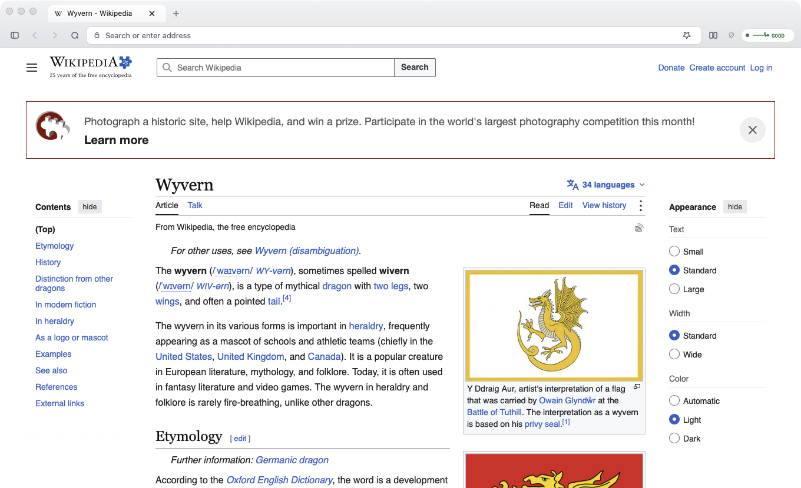<br>A page in the single-bar window. | 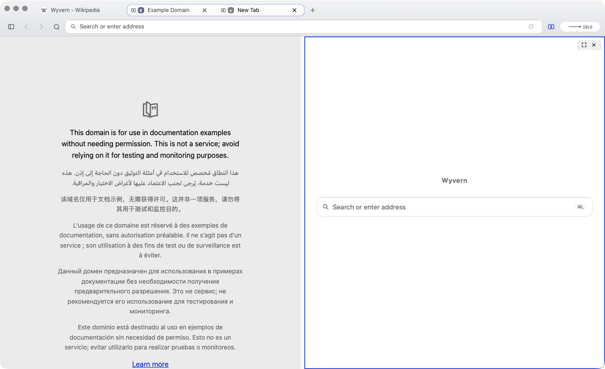<br>Split view: two panes with their tabs grouped in the strip. |
| 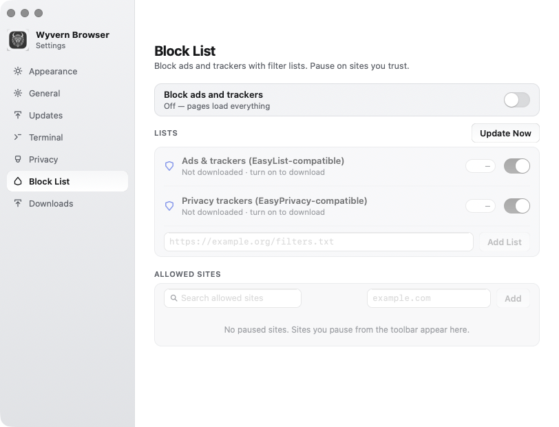<br>The block list settings (off by default). | 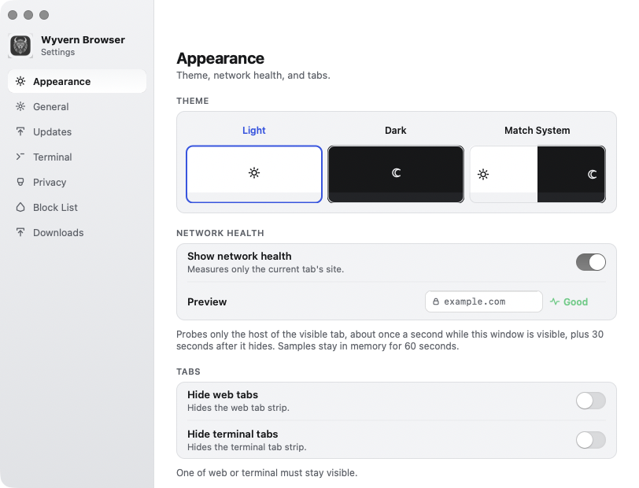<br>Settings. |

Earlier screenshots:

| | |
|---|---|
| 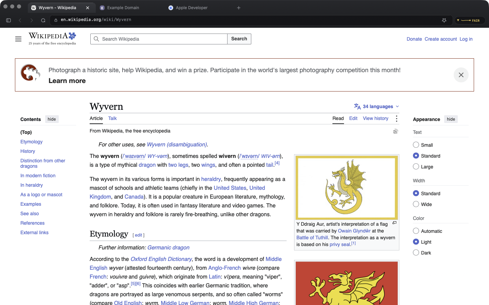<br>A fast, minimal browser for macOS. | 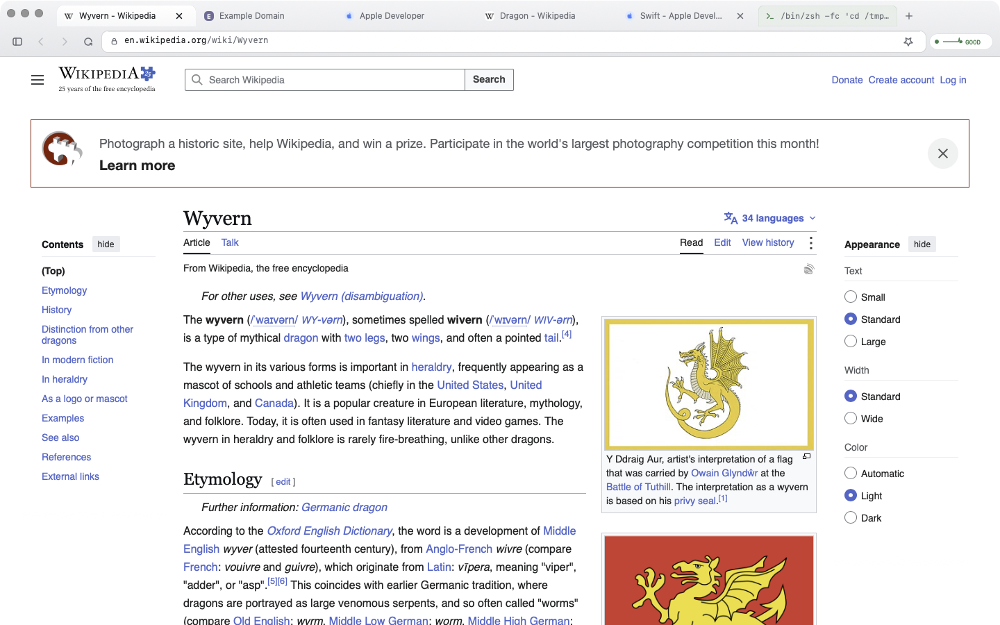<br>Light and dark themes that follow your system. |
| 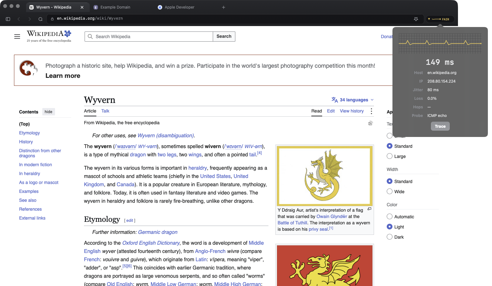<br>Live network health for the current site. | 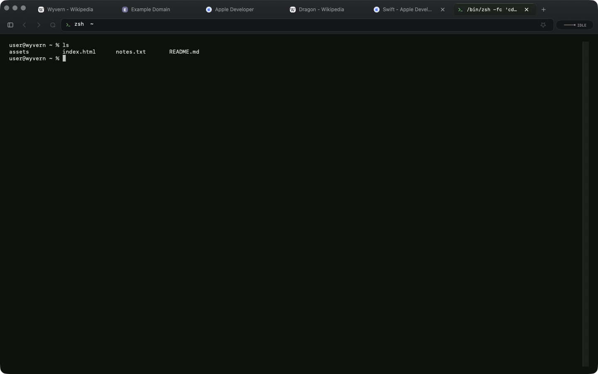<br>Terminal tabs alongside your web tabs. |
| 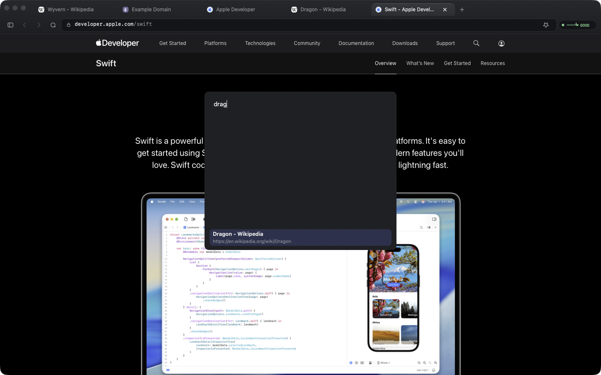<br>Search open tabs (Cmd+Shift+A). | 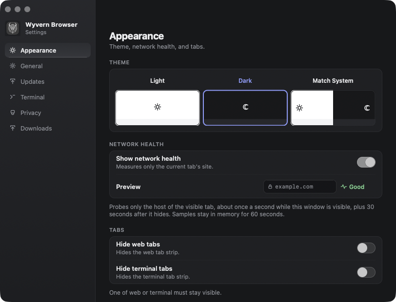<br>Clean, simple settings. |
| 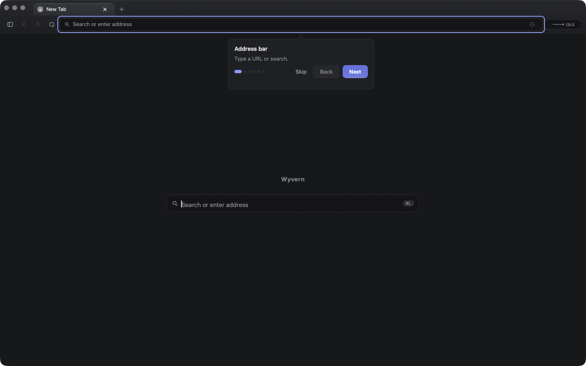<br>A short guided tour on first launch. | |

## Features

- **Native WebKit browsing.** An AppKit app built on the system `WKWebView`.
- **Web and terminal tabs in one tab strip.** Terminal tabs run a local shell (via [SwiftTerm](https://github.com/migueldeicaza/SwiftTerm)), and you can save terminal bookmarks.
- **Network health insight.** A per-site health badge and a health window, backed by TCP-connect and ICMP probes, system DNS lookups, and traceroute.
- **Bookmark import** from other browsers' profiles and from HTML bookmark files.
- **Tiling (split view).** Two to four panes in one window, five layouts, control-command shortcuts; panes can hold any mix of web, terminal, and developer-tools tabs.
- **Developer tools as a tab.** Web Inspector (private WebKit interface) opens next to the page it inspects. Off until you turn it on in settings.
- **Block list.** An ads-and-trackers host block list compiled to WebKit content rules, with a toolbar blocked-count badge and per-site pause. Off by default; lists are only downloaded when you turn it on.
- **Session restore**, **tab search**, and a downloads manager.
- **Per-site permissions**: camera and microphone prompts with remembered choices, plus cookie and site-data controls.
- **Choice of search engine**: DuckDuckGo, Google, Bing, Kagi, Startpage, or a custom one.
- **A signed, opt-in updater (work in progress, see [Updating](#updating)).** It checks only when you ask, and it installs only updates signed with the pinned minisign key.

## Requirements

- macOS 13 (Ventura) or later
- Swift 5.9 or later (Package.swift uses `swift-tools-version:5.9`). A recent Xcode or the Xcode Command Line Tools provides it.
- Building a universal binary needs Apple Silicon and Intel toolchains. `build-app.sh` falls back to arm64-only if the x86_64 build fails.

## Build and install

```bash
git clone https://github.com/AiLabGuy/wyvern.git
cd wyvern

swift build -c release --product Wyvern   # compile only
swift test --filter WyvernCoreTests       # unit tests
bash scripts/build-app.sh               # builds "build/Wyvern Browser.app" (ad-hoc signed)
bash scripts/make-dmg.sh                # optional: disk image from the built app
```

To install, copy `build/Wyvern Browser.app` into `/Applications`. You can also open the disk image and drag the app onto the `Applications` link.

The product name, bundle ID, and version live in `config/product.env`. Change `BUNDLE_ID` (default `com.example.wyvern`) before you distribute your own build.

## Updating

**Status:** the updater is a work in progress. It already handles GitHub release download links and any `latest.json` feed on public HTTPS (GitHub, Gitea, or your own web server), but **the v0.1.0 download has no built-in update source and no release signing key**, so it will not find updates by itself. Until a signed release exists, download new versions from the Releases page, or point Wyvern at your own signed source in **Settings > Updates** (see [Using your own update source](#using-your-own-update-source)).

### In-app updates (default source: GitHub Releases)

Choose **Check for Updates…** in the app menu or in **Settings > Updates**. Wyvern never checks on its own. It downloads the newest release from this repository's GitHub Releases:

```
https://github.com/AiLabGuy/wyvern/releases/latest/download/latest.json
```

It installs the update only if the release carries a valid minisign signature from the project's release key, then relaunches. GitHub redirects these downloads to its download servers over HTTPS; the updater follows that redirect.

> **Placeholder:** the release public key in `config/product.env` is a placeholder until the project publishes its first signed release. While it is a placeholder, `scripts/build-app.sh` builds with no built-in update source (it prints a warning), and in-app updates do nothing until you set a source in Settings. Maintainers: run `bash scripts/new-release-key.sh`, commit the pinned public key, add the `MINISIGN_SECRET_KEY` and `MINISIGN_PASSWORD` repo secrets, and push a `v<version>` tag; `.github/workflows/release.yml` builds, signs, and uploads the zip and `latest.json`.

### Manual update (from source)

```bash
cd wyvern                      # your clone
git pull
bash scripts/build-app.sh      # same build command as above
```

Then:

1. Quit Wyvern.
2. Keep the current copy as a fallback:
   `mv "/Applications/Wyvern Browser.app" "/Applications/Wyvern-old.app"`
3. Install the new build:
   `cp -R "build/Wyvern Browser.app" /Applications/`
4. Relaunch: `open "/Applications/Wyvern Browser.app"`

Check the installed version with **Wyvern > About Wyvern**, or run:

```bash
defaults read "/Applications/Wyvern Browser.app/Contents/Info.plist" CFBundleShortVersionString
```

If the new build has a problem, quit it, delete it, and rename `Wyvern-old.app` back to `Wyvern Browser.app`. Once the new version works, you can delete `Wyvern-old.app`.

## Using your own update source

You can serve updates from your own GitHub Releases, a Gitea generic package, or any HTTPS host, signed with your own key. The feed is a JSON document (`latest.json`), not an XML appcast; [docs/UPDATES.md](docs/UPDATES.md) has the format.

1. **Generate a key pair** (needs [minisign](https://jedisct1.github.io/minisign/), `brew install minisign`):
   ```bash
   bash scripts/new-release-key.sh      # secret key goes to ~/.minisign/, outside the repo
   ```
   Never commit the secret key (`*.key` is gitignored). The script prints the public key (the line starting with `RW`).
2. **Set the key.** The script already pins it in `config/product.env` (`UPDATE_PUBLIC_KEY`) for builds you make. To pin a key you already have, run `bash scripts/set-update-key.sh <public-key>`.
3. **Publish `latest.json` and the signed zip** side by side over HTTPS:
   - GitHub Releases: push a `v<version>` tag and let `.github/workflows/release.yml` do it (repo secrets `MINISIGN_SECRET_KEY`, `MINISIGN_PASSWORD`). Feed URL: `https://github.com/<owner>/<repo>/releases/latest/download/latest.json`.
   - Gitea generic package: upload both files to one package version, e.g. `https://gitea.example.com/api/packages/<owner>/generic/wyvern/latest/latest.json` (the package must be public).
   - Any HTTPS host: put both files in one folder.
   Sign and package each release as shown in [docs/UPDATES.md](docs/UPDATES.md), and check it with `swift run WyvernUpdateVerify` before publishing.
4. **Point Wyvern at it.** Either open **Settings > Updates** and enter the feed URL and public key (they are saved together; **Reset to Default** goes back), or set `UPDATE_FEED_URL` and `UPDATE_PUBLIC_KEY` in `config/product.env` and rebuild. Values in `config/product.env` take precedence over the environment. A release build accepts only a public `https://host[:port]/path` URL with no user info, query, fragment, or private/local host.

## Security

Read [SECURITY.md](SECURITY.md) for how to report a vulnerability and [docs/SECURITY-REPORT.md](docs/SECURITY-REPORT.md) for what was reviewed before v0.1.0, what was found and fixed, and the known limitations. The review was done by an automated multi-agent sweep of AI-generated code. It was not an audit by a third party, and nothing there should be read as a claim that Wyvern is secure.

## License

MIT. See [LICENSE](LICENSE).
