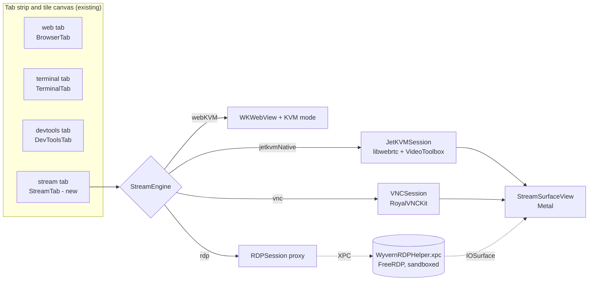
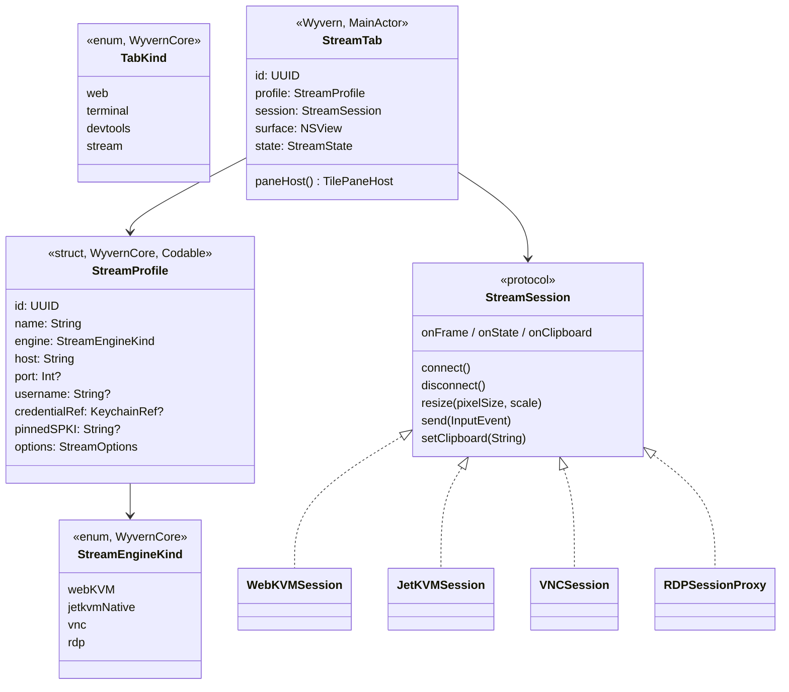
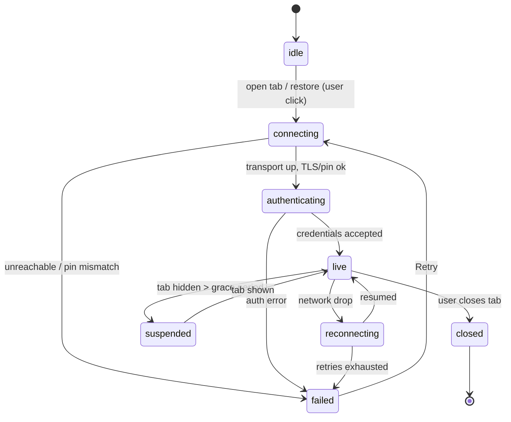
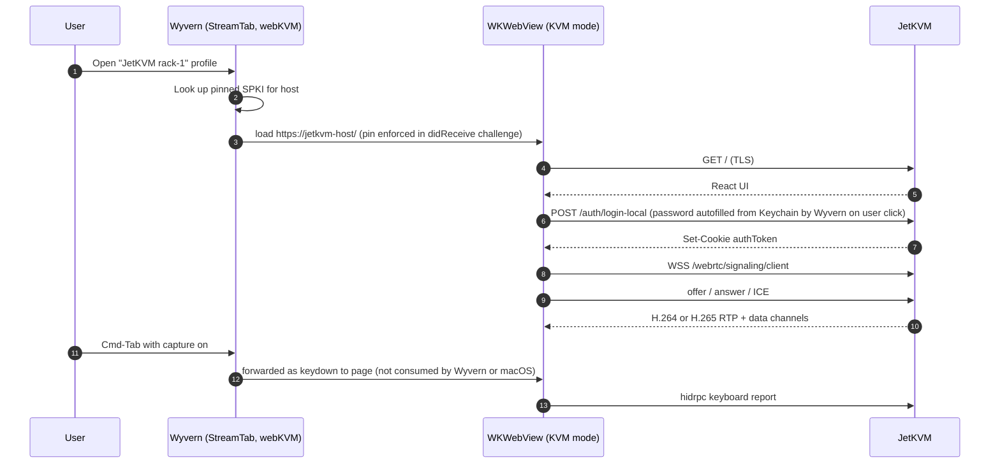
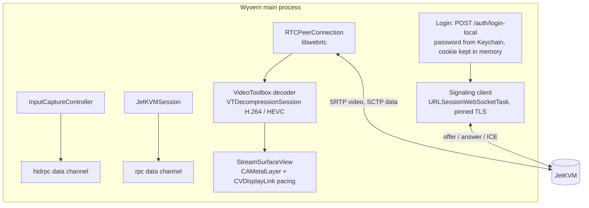
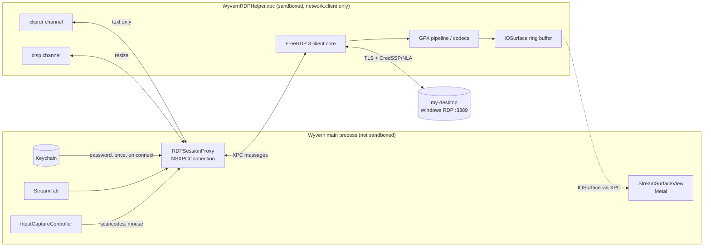
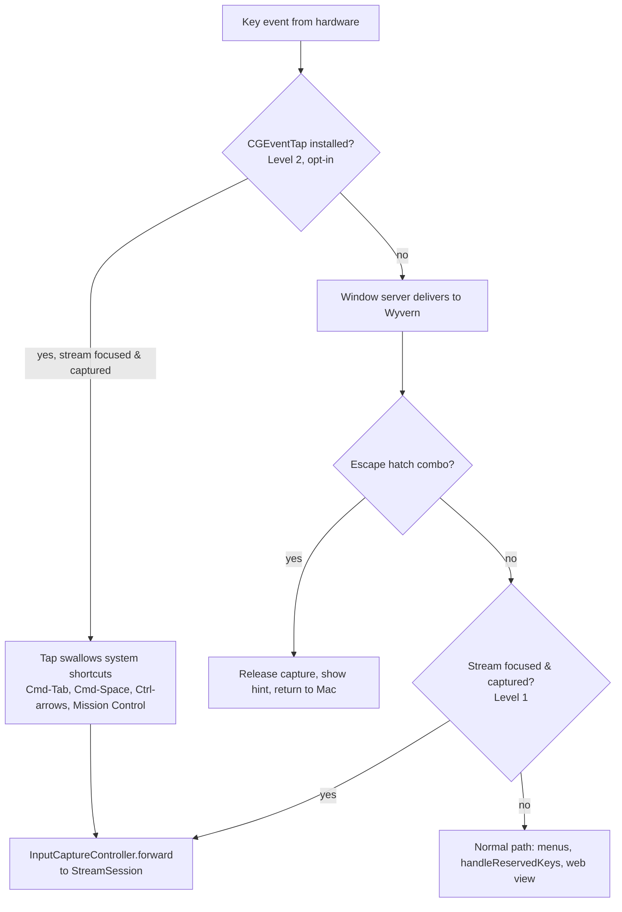
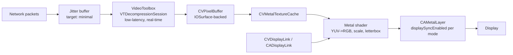
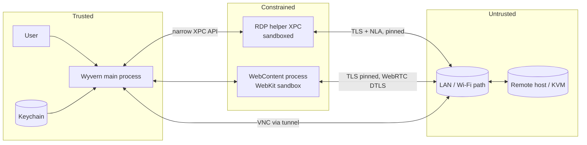
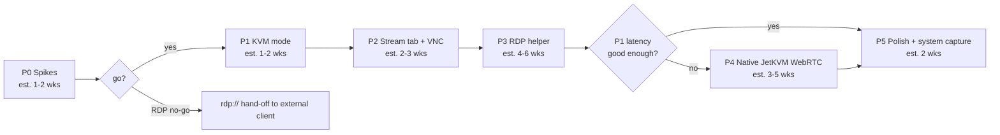

# Wyvern Stream Layer: Architecture (RDP, VNC, JetKVM / web KVM)

| | |
|---|---|
| **Status** | Draft for review. Wave 3 (build 210, Oct 20 2026) shipped the first part of P1: per-site KVM mode with keyboard capture, the escape combo Control-Option-Command-K (Q1 answered for now), no picture-in-picture / remote playback on KVM pages, and no background throttling. Everything else here is design only. |
| **Owner** | Wyvern maintainers |
| **Written** | 2026-10-19 (ET) |
| **Code baseline** | Wyvern v0.1.0 |
| **Related backlog items** | JetKVM optimization; RDP tab type (both added to the wish list on 2026-10-19) |
| **Audience** | Contributors. |

All effort figures in this doc are **estimates** for planning, not commitments. No performance numbers here are measured on Wyvern; where a figure appears it is quoted from its upstream source and labelled as such.

---

## 1. Summary

Wyvern already mixes tab kinds in one strip and tiles 2 to 4 panes of any kind side by side (`TabKind.web`, `.terminal`, `.devtools`; `TileArrangement.maximumPanes = 4`). This doc adds one more tab kind, **`stream`**, that hosts a live remote screen: a JetKVM or other web KVM, a VNC server, or an RDP host. The goal is concrete: RDP into **my-desktop** in one tab, a CLI in another, tile them side by side, and use JetKVM minis without the browser treating the KVM view as a media player.

The plan has three engines behind one tab abstraction:

1. **Web KVM in KVM mode** (cheapest, first). Keep the KVM's own web UI (JetKVM's React app) in a `WKWebView`, but turn on a per-site **KVM mode** that stops media-player treatment, routes Cmd/Option/Ctrl shortcuts to the page, adds an escape hatch, and sets low-latency options.
2. **Native engines**: a built-in **VNC client** (RoyalVNCKit, MIT) in-process, and **RDP via a FreeRDP helper** (Apache-2.0) in a sandboxed XPC service.
3. **Native JetKVM WebRTC handler** (later, gated). Talk to JetKVM's signaling and data channels directly with libwebrtc, decode with VideoToolbox, render with Metal. Only built if KVM mode in WKWebView proves not good enough.

---

## 2. Goals and non-goals

### Goals

- **G1. One more tab kind, not a new app.** Remote sessions are tabs. They tile, reorder, group, restore and close exactly like web, terminal and DevTools tabs.
- **G2. JetKVM works well.** The KVM view is an interactive console, never a media element: no Picture in Picture, no Now Playing or media-key hijack, no "video" fullscreen chrome, and keyboard shortcuts reach the remote machine.
- **G3. RDP to Windows hosts** (first target: my-desktop) with Network Level Authentication, clipboard text, and dynamic resize when the tile changes size.
- **G4. VNC** for Linux/macOS hosts and VM consoles that expose RFB.
- **G5. Full keyboard forwarding** including Cmd, Option, Ctrl and, opt-in, system shortcuts (Cmd-Tab, Cmd-Space, Mission Control), with an escape-hatch key combo that always returns control to the Mac and an on-screen hint that says what it is.
- **G6. Low latency** by default for streams: hardware decode, Metal presentation, small jitter buffer, pacing to the display.
- **G7. Secure by default.** The remote end is untrusted. Credentials live in the Keychain. Self-signed KVM certificates are pinned, not blindly accepted. Protocol parsers that are large C codebases (FreeRDP) run out of process and sandboxed.

### Non-goals (for this design)

- **N1.** Hosting servers. Wyvern is a client only. No VNC/RDP server, no screen sharing *from* the Mac.
- **N2.** JetKVM Cloud. Cloud access uses `api.jetkvm.com` signaling and OIDC. The first versions target local/LAN access (including over a VPN). Cloud can be reconsidered later.
- **N3.** Audio redirection for RDP and VNC in v1. JetKVM audio is handled by its own web UI in KVM mode; native audio is a later phase.
- **N4.** File transfer, drive redirection, printer and smart-card redirection over RDP. RDP drive redirection in particular widens the attack surface and stays off.
- **N5.** RemoteApp, RD Gateway, and RDP over the Internet without a VPN. my-desktop and the KVMs are reached on the LAN or over a VPN.
- **N6.** SPICE, Apple Screen Sharing's proprietary extensions beyond ARD auth, and Proxmox's noVNC console as a native protocol (it already works as a normal web tab).
- **N7.** iPad. Wyvern is a macOS AppKit app; the iPad Safari problem is the motivation, not a target.
- **N8.** Benchmark claims. This doc sets up how to measure (section 15); it does not promise numbers.

---

## 3. What exists today (code survey)

Names below are from the code so the new types line up with them.

| Concept | Current code | Notes for the stream layer |
|---|---|---|
| Tab kind | `WyvernCore/TabKind.swift`: `enum TabKind: String, Codable { case web, terminal, devtools }` | Add `case stream`. Raw value is persisted, see 4.4 for downgrade risk. |
| Strip entry | `Wyvern/SessionTab.swift`: `enum SessionTab { case web(BrowserTab), terminal(TerminalTab), devtools(DevToolsTab) }` | Add `case stream(StreamTab)`. |
| Hide filters | `TabVisibility.allows(_:)` (hide web / hide terminal toggles) | Streams always visible, like DevTools, or get their own toggle later. |
| Pane hosting | `Wyvern/TileCanvasView.swift`: `protocol TilePaneContent { tileView, tileTitle, tileFocusTarget, tileKind }`, adapter `TilePaneHost`, `TilePaneFill { page, terminal }`, `TilePanePillStyle` | The canvas "does not switch on the kind". A `StreamTab` provides a `TilePaneHost` with `kind: .stream`; add `TilePaneFill.stream` (black letterbox). |
| Layout model | `WyvernCore/TileLayout.swift`: `TilePane { tabID, kind }`, `TileSplit`, `TileNode`; `TileArrangement.maximumPanes = 4` | No change beyond the new kind. Four simultaneous streams is a decode-budget concern (section 11). |
| Terminal tabs | `TerminalTab` (SwiftTerm `LocalProcessTerminalView`), launched from `TerminalBookmark` in `TerminalBookmarkStore` with a confirmed-command hash | Model to copy: a `StreamProfile` saved in a `StreamProfileStore`, opened from a picker. |
| New-tab menu | `TerminalBookmarkPicker` ("New Terminal Tab"), File → New Terminal Tab in `AppDelegate`, tab context menu via `TabStripView.menu(for:)` → `contextMenuProvider` | Add "New Remote Tab" (RDP / VNC / KVM) next to the terminal entry; this is the "right-click offers CLI or RDP" request. |
| Session restore | `SessionTabSnapshot { kind, url, terminalBookmarkID, devtoolsSourceIndex }` | Add `streamProfileID: UUID?`. Never persist credentials or live tokens. |
| Settings | `SettingsPane` enum: appearance 1 … blockList 7 | Add `remote = 8` (profiles, certificate pins, input capture, KVM sites). |
| Per-site settings | `SitePermissionKind { camera, microphone, location, notifications, popups, autoplay }`, `SitePermissionChoice { ask, allow, block }` | KVM mode is a per-site choice stored the same way (section 9). |
| Reserved keys | `AppDelegate.installTabKeyMonitor` / `handleReservedKeys` (Cmd-W, Ctrl-Tab, Ctrl-\`, Cmd-N) via `NSEvent.addLocalMonitorForEvents` | Must yield to the stream when input capture is on, except the escape hatch (section 10). |
| Media config | `BrowserTab` sets `mediaTypesRequiringUserActionForPlayback` from the autoplay choice | KVM mode overrides media behavior for its site. |
| Process model | Not App Sandboxed. `Wyvern.entitlements` has camera and audio input only. Hardened runtime on. macOS 13.0 deployment target. MIT. | XPC services can carry their own sandbox entitlement even though the main app does not. License constrains library choice (section 7.3). |

---

## 4. The stream tab abstraction

### 4.1 Types

- **`StreamProfile`** (WyvernCore, pure value type, unit-testable on Linux CI like the rest of WyvernCore). Saved in `StreamProfileStore` beside `TerminalBookmarkStore`, as a JSON file written with the existing `PrivateFile` helper. It holds **no secret**: only a Keychain reference.
- **`StreamEngineKind`**: `webKVM` (KVM's web UI in WKWebView with KVM mode), `jetkvmNative`, `vnc`, `rdp`.
- **`StreamSession`** (protocol, Wyvern): one live connection. Engines implement it. The tab never switches on the engine.
- **`StreamTab`** (Wyvern, `@MainActor`): owns the session, the surface view, the connection state and the input capture state. It vends a `TilePaneHost(view:title:focus:kind: .stream)` so `TileCanvasView` hosts it with no new branch.
- **`StreamState`**: `idle → connecting → authenticating → live → (reconnecting | failed | closed)`.
- **`StreamSurfaceView`**: the Metal-backed view the native engines draw into. The `webKVM` engine's surface is a `WKWebView` instead.

### 4.2 Lifecycle and tiling

- **Restore never auto-connects to RDP/VNC.** A restored stream tab shows a "Connect to my-desktop" placeholder; one click connects. This avoids a burst of credential prompts and connection attempts at launch, and matches the existing "user confirms commands" posture of terminal bookmarks.
- **Hidden tabs** (not in a visible pane) pause video decode after a grace period (estimate 30 s, configurable) but keep the connection. RDP gets a suppress-output PDU; VNC stops requesting framebuffer updates; JetKVM native stops rendering (JetKVM's own UI has a similar idea in `useHiddenVideoStreamPause.ts`).
- **Tile resize** calls `session.resize(pixelSize, backingScale)` debounced (estimate 150–300 ms after the last drag). RDP uses the Display Control channel to change the remote resolution; VNC asks via ExtendedDesktopSize if the server allows it, otherwise scales locally; JetKVM always scales locally (the capture resolution comes from the host's HDMI output).
- **Focus**: `tileFocusTarget` is the surface. Input capture is only active while the stream pane is first responder **and** the window is key.

### 4.3 Opening a stream tab

- New-tab button menu and File menu get **New Remote Tab ▸** with the saved profiles (RDP, VNC, KVM) and "New connection…". This sits next to the existing terminal bookmark entries, so right-click → CLI or RDP is one menu.
- A web tab on a site in KVM mode is still a **web** tab (kind `web`) with KVM mode on; "Open as Remote Tab" converts it to a `stream` tab with the `webKVM` engine so it gets the stream pill, restore placeholder and capture rules. This keeps plain web browsing of the KVM's settings pages working as normal web tabs.

### 4.4 Persistence and the downgrade risk

`SessionTabSnapshot` gains `streamProfileID: UUID?`. `TabKind` is decoded from its raw string; an older Wyvern build reading a snapshot containing `"stream"` would fail to decode that tab record. **Mitigation:** decode `TabKind` leniently (unknown raw value → skip that tab, keep the rest), and ship that lenient decoder at least one release *before* the build that writes `"stream"`. Add a test like the existing `SessionSnapshotTests`.

---

## 5. JetKVM: verified protocol facts

Verified against the public JetKVM source, **github.com/jetkvm/kvm at commit `8f6c3001b1064eb32b3f66afd04efbe536bbaf87` (2026-10-05)**, GPL-2.0, plus the public docs at jetkvm.com/docs. Links are permalinks to that commit.

| Question | Finding | Source |
|---|---|---|
| Transport | **WebRTC**, implemented on the device with Pion (`github.com/pion/webrtc/v4 v4.2.1`). The device answers; the browser creates the offer. | `go.mod`; `webrtc.go` `ExchangeOffer` |
| Video codec | **H.264**, or **H.265** when the device preference is `h265` or `auto` *and* the browser's SDP offer advertises H265. Otherwise falls back to H.264. | [`webrtc.go` `resolveCodec`](https://github.com/jetkvm/kvm/blob/8f6c3001b1064eb32b3f66afd04efbe536bbaf87/webrtc.go#L189-L209) |
| Upstream latency claim | "1080p@60FPS video with 30-60ms latency using H.264 encoding" (vendor claim, not measured by us) | [README](https://github.com/jetkvm/kvm/blob/8f6c3001b1064eb32b3f66afd04efbe536bbaf87/README.md), jetkvm.com/docs |
| Audio | Optional. G.722 or PCMU (8 kHz RTP clock) if enabled and offered. | [`webrtc.go` `negotiateAudioCodec`](https://github.com/jetkvm/kvm/blob/8f6c3001b1064eb32b3f66afd04efbe536bbaf87/webrtc.go#L137-L148) |
| Jitter control | Device adds the RTP **playout-delay** header extension with min=max=0 on video packets to keep the receiver's jitter buffer at its floor. | [`internal/playoutdelay/interceptor.go`](https://github.com/jetkvm/kvm/blob/8f6c3001b1064eb32b3f66afd04efbe536bbaf87/internal/playoutdelay/interceptor.go) |
| Input | **WebRTC data channels**, created by the client: `hidrpc` (reliable), `hidrpc-unreliable-ordered`, `hidrpc-unreliable-nonordered`, plus `rpc` (JSON-RPC control), `terminal`, `serial`, `cdcacm`, and upload channels. | [`webrtc.go` `OnDataChannel`](https://github.com/jetkvm/kvm/blob/8f6c3001b1064eb32b3f66afd04efbe536bbaf87/webrtc.go#L552-L595); `ui/src/routes/devices.$id.tsx` |
| HID wire format | Binary "HID RPC" v1: first byte is the message type. `0x01` handshake, `0x02` keyboard report (modifier byte + key codes, USB HID style), `0x03` pointer (absolute), `0x04` wheel, `0x05` keypress, `0x06` mouse (relative), `0x07` keyboard macro, `0x08` cancel macro, `0x09` keypress keep-alive; device→client `0x32` LED state, `0x33` keydown state, `0x34` macro state. | [`internal/hidrpc/hidrpc.go`](https://github.com/jetkvm/kvm/blob/8f6c3001b1064eb32b3f66afd04efbe536bbaf87/internal/hidrpc/hidrpc.go), `internal/hidrpc/message.go` |
| Mouse modes | Absolute and relative; the web UI uses Pointer Lock for relative. | `ui/src/hooks/useMouse.ts`, `ui/src/components/WebRTCVideo.tsx` |
| Signaling | **WebSocket** at `GET /webrtc/signaling/client` (`ws:` or `wss:` matching the page). JSON messages `{type, data}`: device sends `device-metadata`; client sends `offer` with `data.sd = base64(JSON(RTCSessionDescription))`; device replies `answer`; both sides send `new-ice-candidate`. A legacy `POST /webrtc/session` remains for upgrade compatibility. Cloud mode uses `wss://api.jetkvm.com/webrtc/signaling/client?id=<deviceId>`. | [`web.go` routes](https://github.com/jetkvm/kvm/blob/8f6c3001b1064eb32b3f66afd04efbe536bbaf87/web.go#L198-L210); `web.go` signaling loop; `ui/src/webrtc/signaling/useWebSocketSignaling.ts` L265–270, L456–457 |
| ICE | Local mode configures no STUN/TURN; host (and optionally mDNS) candidates. Cloud mode uses ICE servers handed out by the cloud. | `webrtc.go` `newSession` (ICE server block) |
| Auth (local) | Two modes: `noPassword` (no auth at all) or `password`. `POST /auth/login-local {password}` (bcrypt check, rate-limited) sets an **`authToken` cookie** (HttpOnly, **not** `Secure`, 7-day max age). Protected routes, including the signaling WebSocket, require that cookie. | [`web.go` `handleLogin`, `protectedMiddleware`](https://github.com/jetkvm/kvm/blob/8f6c3001b1064eb32b3f66afd04efbe536bbaf87/web.go#L459-L535) |
| Origin check | The signaling WebSocket accepts any Origin (`InsecureSkipVerify: true` in the accept options). | `web.go` `handleLocalWebRTCSignal` |
| TLS | Modes `disabled` (default, plain HTTP on :80), `self-signed` (device CA "JetKVM Self-Signed CA", default name `jetkvm.local`; needs the device clock synced), or `custom` (user PEM). HTTPS on :443. | [`web_tls.go`](https://github.com/jetkvm/kvm/blob/8f6c3001b1064eb32b3f66afd04efbe536bbaf87/web_tls.go); GitHub issue jetkvm/kvm#40 |
| Media encryption | WebRTC media and data channels are DTLS/SRTP encrypted. With TLS disabled, the SDP (including the DTLS fingerprint) crosses the LAN over plain `ws:`, so an on-path attacker could substitute it. | Pion defaults; issue #40 comment |
| Browser features the UI uses | `navigator.keyboard.lock()` (Keyboard Lock API) in fullscreen, `requestPointerLock()`, element fullscreen; the `<video>` is `autoPlay muted playsInline disablePictureInPicture controlsList="nofullscreen"`, audio in a separate `<audio>` element. | `ui/src/components/WebRTCVideo.tsx` L197–281, L735–742 |

**What this means for Wyvern**

- WebKit does not implement the Keyboard Lock API, so in any WebKit browser JetKVM cannot grab Cmd-Tab, Cmd-Space or Cmd-W on its own. Wyvern can supply that natively (section 10). That is the single biggest usability win and is available in phase 1 without a native WebRTC stack.
- The page already marks its video as non-PiP and non-fullscreen. The remaining media-player behavior (Now Playing integration, media keys, Space toggling playback, AirPlay) is controlled from the browser side, which is exactly what KVM mode toggles.
- **iPad note:** we did not reproduce or diagnose the iPad Safari "media window" behavior; it is the motivation, not a verified root cause. On macOS, KVM mode covers the browser-side causes we can control.
- A native client is feasible because the protocol is small, documented in source, and stable enough to have a back-compat endpoint. It is still an **unofficial** client of a GPL-2.0 project's private protocol; we reimplement the wire format from observation and must not copy JetKVM code into MIT-licensed Wyvern.

---

## 6. Engine 1: Web KVM in KVM mode, and the native JetKVM handler

### 6.1 Phase-1 path: JetKVM's own UI in WKWebView

Pros: almost no protocol code, all JetKVM features (virtual media, settings, macros, terminal) keep working, and updates on the device side do not break us. Cons: decode, jitter buffer and frame pacing are WebKit's; we cannot pin the playout delay beyond what WebKit honors.

### 6.2 Phase-4 path: native JetKVM handler (`JetKVMSession`)

Only if phase-1 measurements (section 15) show WebKit's receive path is the bottleneck.

- **WebRTC stack:** Google libwebrtc (BSD-3-Clause), consumed as a prebuilt `WebRTC.xcframework`. Its default macOS video decoder factory already uses VideoToolbox for H.264 (and H.265 where built in); we provide a custom renderer that takes `CVPixelBuffer`s straight into Metal. Pion (MIT, Go) is the alternative for a helper process; libwebrtc is preferred because it brings congestion control, NACK/PLI handling and a tunable jitter buffer.
- **Offer:** advertise H.265 when VideoToolbox supports HEVC decode on the Mac; the device then picks H.265 under `auto`. Create the same data channel labels as the official UI (`rpc`, `hidrpc`, `hidrpc-unreliable-ordered`, `hidrpc-unreliable-nonordered`).
- **Input:** encode HID RPC v1 messages: handshake, keyboard reports from a local USB HID usage table, absolute pointer reports normalized to the video rect, wheel. Pointer moves go on the unreliable-ordered channel, key and button events on the reliable one, matching the official client's split.
- **Controls:** `rpc` JSON-RPC for state we need (video state, USB state, keyboard LEDs). Everything else (virtual media, settings) opens the device's web UI in a normal web tab.
- **Fallback:** a toolbar button "Open device UI" switches the tab to the `webKVM` engine.
- **Compatibility guard:** on connect, read `device-metadata.deviceVersion`. Keep a tested-versions range; outside it, warn and offer the web UI engine. A protocol change on the device must degrade to the web path, not break the tab.

---

## 7. Engine 2: built-in VNC client

### 7.1 Protocol scope (RFB 3.8, RFC 6143 plus community extensions)

- **Security types:** None (1), VNC Authentication (2, DES challenge; weak, see section 13), Apple Remote Desktop (30) for macOS Screen Sharing, VeNCrypt (19) is **not** supported by the chosen library, so TLS for VNC comes from the tunnel (a VPN or SSH), not from RFB.
- **Encodings, in preference order:** Tight (7, with JPEG quality and compression level pseudo-encodings), ZRLE (16), Zlib (6), Hextile (5), CopyRect (1), RRE/CoRRE, Raw (0).
- **Pseudo-encodings:** Cursor (-239, local cursor for latency), DesktopSize (-223), ExtendedDesktopSize (-308, also lets us request a resize), LastRect (-224), ContinuousUpdates (-313), DesktopName.
- **Keyboard:** standard KeyEvent sends X11 keysyms; QEMU Extended Key Event (scancodes) would be better for layout fidelity on VM consoles but is not in the chosen library today (open question).

### 7.2 Library choice

| Option | License | Fit | Verdict |
|---|---|---|---|
| **RoyalVNCKit** (github.com/royalapplications/royalvnc) | **MIT** (deps: CryptoSwift, zlib, stb public domain, D3DES public domain) | Swift, SwiftPM, macOS 11+. Security: None, VNC password, ARD, UltraVNC MS-Logon II. Encodings: Tight, Zlib, ZRLE, Hextile, CoRRE, RRE, CopyRect. Pseudo: Cursor, DesktopSize, ExtendedDesktopSize, ContinuousUpdates, LastRect, compression and JPEG levels. Text clipboard both ways. Ships an NSView framebuffer view. | **Chosen.** License is compatible with MIT; just add it to `THIRD_PARTY_LICENSES.md` and `LICENSES/`. We use its connection/decoder layer and our own `StreamSurfaceView` and input path so all engines share capture and rendering. |
| LibVNCClient (github.com/LibVNC/libvncserver) | **GPL-2.0** (GitHub-reported) | Mature C, wide encoding support, VeNCrypt/TLS | **Rejected for linking.** GPL-2.0 code linked into the app conflicts with distributing Wyvern under MIT. Could only be considered as a separately distributed helper, which is not worth the legal ambiguity. |
| Own Swift RFB implementation | Ours (MIT) | Full control, small | Fallback if RoyalVNCKit blocks us. Estimate 3–5 weeks for parity with the list above. |

Its `NSView` handles input itself; we bypass that view so the escape hatch and capture rules are identical across engines. Pin an exact version (same policy as the SwiftTerm pin noted in `SECURITY-REPORT.md` S2-15).

### 7.3 Licensing summary for the stream layer

| Component | License | How used | Compatible with MIT distribution |
|---|---|---|---|
| RoyalVNCKit | MIT | Linked in-process | Yes (notice required) |
| FreeRDP 3.x (github.com/FreeRDP/FreeRDP, latest release 3.32.2 on 2026-10-12) | Apache-2.0 | Linked into the XPC helper | Yes (notice; FreeRDP's own optional deps must be checked: e.g. OpenSSL 3 is Apache-2.0; avoid building with FFmpeg GPL components) |
| libwebrtc | BSD-3-Clause (+ bundled third-party notices) | Linked in-process (phase 4) | Yes (notices) |
| JetKVM | GPL-2.0 | **Not used.** Protocol reimplemented; no code copied. | n/a |
| LibVNCClient | GPL-2.0 | Not used | No (for linking) |

---

## 8. Engine 3: RDP via a native helper (FreeRDP over XPC)

### 8.1 Why a helper

FreeRDP is a large C codebase that parses everything the remote server sends: bitmap codecs (RemoteFX, planar, interleaved, AVC420/AVC444 H.264 via the graphics pipeline), virtual channels (clipboard, display control) and TLS/CredSSP. A bug there must not take down every tab or reach the user's browsing data. So it runs in its own process:

- **`WyvernRDPHelper.xpc`** inside `Wyvern Browser.app/Contents/XPCServices/`, one helper **instance per RDP tab** (XPC service with `ServiceType = Application` semantics via `NSXPCConnection` per tab, or a launch-per-session helper if a single service multiplexes poorly; decide in the spike).
- The helper is **App Sandboxed** with only `com.apple.security.network.client`. No file access, no camera/mic, no Keychain access group. The main app is not sandboxed today; the helper still can be.
- Hardened runtime, same Team ID check on both ends of the connection (`NSXPCConnection` code-signing requirement) once the app is Developer-ID signed. Until then (v0.1.0 is ad-hoc signed), the helper validates the connection's audit token belongs to its parent bundle path.

### 8.2 Data path

- **Frames:** the helper renders into a small ring of `IOSurface`s and sends each surface once over XPC (`IOSurfaceCreateXPCObject`), then only "surface N, dirty rects" notifications. The main process wraps them as `MTLTexture`s, so frames cross the process boundary without copies.
- **Decode:** FreeRDP's AVC (H.264) decoding backend on macOS must be confirmed in the spike. If it does not use VideoToolbox, add a decoder shim that hands AVC420 NAL units to `VTDecompressionSession` (open question Q4).
- **Input:** RDP takes keyboard **scancodes**, which avoids keysym layout problems. Map macOS virtual key codes → PC/AT scancodes with a table and a per-profile "Cmd acts as" option (Ctrl or Windows key; default Ctrl for copy/paste muscle memory, Windows key reachable via Cmd+Option or an explicit menu).
- **Resize:** tile size changes go through the Display Control channel (dynamic resolution). Hosts without it get local scaling.
- **Crash isolation:** the proxy installs XPC `interruptionHandler`/`invalidationHandler`. A helper crash puts the tab in `failed` with "The RDP helper stopped. Reconnect?"; other tabs, including other RDP tabs, are unaffected. Crash reports stay local.

### 8.3 Authentication and credentials

- **NLA (CredSSP) required by default.** Plain RDP security and TLS without NLA are refused unless the profile explicitly allows it (with a warning).
- Server certificate: RDP hosts like my-desktop use self-signed certificates. First connection shows the certificate SHA-256 fingerprint and pins it (TOFU). A changed certificate blocks the connection with a clear prompt to re-pin.
- Password stored as a Keychain **generic password** item, service `com.<bundle>.stream.<profileID>`, `kSecAttrAccessibleWhenUnlockedThisDeviceOnly`, not synchronizable. Fetched by the main process on connect, handed to the helper once over XPC, zeroed after the CredSSP exchange. The helper never touches the Keychain.
- No credentials in the session snapshot, the profile JSON, logs, or crash reports. FreeRDP's own logging is set to WARN and filtered for argument strings.

## 9. Per-site KVM mode

A per-site choice (stored like `SitePermissionKind`, scoped to scheme+host+port) that the user turns on from the site menu or that is pre-set on a `webKVM` stream profile. Default off for every site.

| Toggle | Effect when KVM mode is on | Why |
|---|---|---|
| **No media-player treatment** | Disable Picture in Picture, AirPlay (`allowsAirPlayForMediaPlayback = false`), Now Playing / Media Session integration and hardware media-key handling for this web view; Space and media keys go to the page. | The remote screen is a console, not a video (the iPad pain point). |
| **Autoplay** | Allow without user action for this site (video is muted by the page; audio follows the site's autoplay choice). | The stream must start on load. |
| **Input capture available** | Shows the capture toggle in the address bar; when engaged, Cmd/Option/Ctrl shortcuts are delivered to the page instead of Wyvern's menus (section 10). | WebKit lacks Keyboard Lock. |
| **Pointer lock** | Allow the page's `requestPointerLock()` without extra prompts while in KVM mode; Wyvern shows its escape hint. | Relative-mouse mode for BIOS/OS installers. |
| **Element fullscreen** | Allowed; entering it auto-engages capture (with the hint). Leaving fullscreen releases capture. | Matches JetKVM's own fullscreen + keyboard-lock flow. |
| **Low-latency hints** | Keep the tab out of background throttling while visible in a pane; disable smooth-scrolling/rubber-banding over the video; no back/forward swipe gestures. | Avoid accidental navigation and timer throttling. |
| **Content blocker** | Exempt the site from cosmetic filtering (block list stays on for network rules). | Prevent filters from hiding KVM UI. |
| **Do not translate / no reader / no autofill prompts over the video** | Suppress overlays except the escape hint. | Overlays steal focus. |

Exact WKWebView knobs for "Now Playing" and media keys on macOS 13+ need confirming in the phase-0 spike (some are SPI; the security report already flags SPI use for the inspector, so prefer public API and accept a smaller toggle set if needed).

---

## 10. Input capture and forwarding

### 10.1 Levels of capture

- **Level 0 (off):** a stream behaves like any view; Wyvern menus win. Default for a newly opened tab until the user clicks into the stream.
- **Level 1 (in-view capture, no permission needed):** while the stream pane is first responder, the window is key and capture is engaged, Wyvern's local monitor (`AppDelegate.handleReservedKeys`) and menu key equivalents step aside. `StreamSurfaceView` overrides `performKeyEquivalent(with:)`, `keyDown`, `keyUp` and `flagsChanged` so Cmd-W, Cmd-Q, Cmd-T, Cmd-C/V, Option and Ctrl combos reach the remote. For the `webKVM` engine, the web view simply receives these events instead of the menu. Covers most needs with **no system permission**.
- **Level 2 (system shortcuts, opt-in):** a session-level `CGEventTap` (`CGEvent.tapCreate(tap: .cgSessionEventTap, place: .headInsertEventTap, options: .defaultTap, …)`) active only while a captured stream is focused, to also grab Cmd-Tab, Cmd-Space, Cmd-\`, Ctrl-arrow Space switching and Mission Control keys. Needs the user to grant **Accessibility** (to modify/swallow events) in System Settings › Privacy & Security; listen-only taps need **Input Monitoring**. Some combinations are reserved by the system and may not be interceptable even with a tap (e.g. secure input fields, the power-key chords, Force Quit); we document rather than fight them.

The tap is created lazily, disabled whenever capture is off, re-enabled after `tapDisabledByTimeout`, and torn down when the last captured stream closes. If permission is not granted, Level 1 still works and the hint says so.

### 10.2 Escape hatch

- **Proposed default: Ctrl+Option+Return** (⌃⌥↩), configurable in Settings › Remote. It is rarely used by Windows, common Linux desktops or BIOS setup screens. Rejected alternatives: Ctrl+Option+Cmd+Esc (awkward, too close to Force Quit) and a double-tap of a modifier (ambiguous with normal remote typing). Final choice is open question Q1.
- The combo is checked **first**, in the tap (Level 2) and in the local monitor (Level 1), before any forwarding, and is never forwarded.
- **Second escape:** clicking outside the stream pane, Cmd-Tab when Level 2 is off, or the window losing key status always releases capture.
- **Stuck-key safety:** on release, send key-up for every key the remote believes is down (RDP and VNC need explicit releases; JetKVM gets an all-zero keyboard report).
- **On-screen hint:** when capture engages, a small non-interactive pill at the top of the pane for ~3 s: "Keyboard captured. Press ⌃⌥↩ to release." A persistent lock glyph stays in the pane's pill (uses `TilePanePillStyle`, new `.stream` style) while captured. The hint is drawn by Wyvern, outside the remote content, so a remote screen cannot fake or hide it.

### 10.3 Mapping

| Engine | Keyboard | Pointer |
|---|---|---|
| webKVM | Native NSEvents delivered to WebKit; page maps to HID | Page-controlled (absolute or Pointer Lock) |
| jetkvmNative | macOS key code → USB HID usage → HID RPC keyboard report (modifier byte + up to 6 keys) | Absolute reports normalized to the letterboxed video rect; relative mode uses `CGAssociateMouseAndMouseCursorPosition(false)` + hidden cursor |
| vnc | key code → X11 keysym (layout-aware via `UCKeyTranslate`) | PointerEvent with button mask; server cursor drawn locally via Cursor pseudo-encoding |
| rdp | key code → PC/AT scancode (layout-independent) | Absolute mouse PDUs; extended buttons and horizontal wheel |

Cmd maps to Ctrl or Windows/Super per profile. Option → Alt. Mac-only keys (Fn, Globe) are not forwarded.

---

## 11. Hardware decode, rendering, and latency

- **Decode:** VideoToolbox with `kVTDecompressionPropertyKey_RealTime = true`, output `kCVPixelFormatType_420YpCbCr8BiPlanarVideoRange` (NV12), IOSurface-backed so Metal can sample it without a copy. H.264 always; HEVC when supported and negotiated (JetKVM `auto`). VNC and most RDP bitmap codecs are CPU-decoded by their libraries and uploaded as BGRA textures with dirty-rect updates.
- **Render:** one `CAMetalLayer` per stream pane. YUV→RGB in a fragment shader, aspect-fit with black letterbox, nearest-neighbor option for crisp text at integer scale, linear otherwise. `presentsWithTransaction = false`.
- **Frame pacing:** present on the display link. Policy "latest frame wins": if two frames arrive within one refresh, drop the older one; never queue more than one frame ahead. `displaySyncEnabled` on by default; an option turns it off for lowest latency at the cost of tearing.
- **Jitter buffer:** for the native JetKVM path, honor the device's playout-delay (0/0) and configure libwebrtc's minimum playout delay to zero; let NACK/PLI recover losses instead of buffering. Expose a "smoothness vs latency" slider later if Wi-Fi users need it.
- **Low-latency input:** send input immediately on the event (no coalescing per frame for keys; pointer moves coalesced to at most one per display refresh), on the unreliable-ordered channel for pointer moves (JetKVM) or the fast-path input PDUs (RDP).
- **Budget with four panes:** VideoToolbox decode is hardware, but four 1080p60 streams plus WebKit is untested. The phase-2 gate includes a 4-pane test; if it struggles, non-focused panes drop to a lower presentation rate.

---

## 12. Clipboard, multi-monitor and scaling

### Clipboard

| Engine | Mechanism | v1 behavior |
|---|---|---|
| RDP | `cliprdr` virtual channel | Text (UTF-16) both ways. Images and files off. |
| VNC | ClientCutText / ServerCutText (Latin-1 in base RFB; RoyalVNCKit provides text both ways) | Text both ways; non-Latin-1 characters may be lost with servers lacking the extended clipboard extension. |
| JetKVM | No clipboard channel; the device types text via HID keyboard macros (`0x07` keyboard macro) | "Paste as keystrokes" command (local → remote only), with a confirmation for text over a size threshold and a cancel button (`0x08`). |

Rules: clipboard sync is **per profile, default "local → remote only on explicit paste"**; remote → local is opt-in per profile, because a compromised remote could otherwise push content (e.g. a shell command) into the Mac clipboard silently. Remote → local updates only happen while the tab is focused, and show a brief "Clipboard updated from my-desktop" toast.

### Multi-monitor and scaling

- **Retina:** request remote resolution in **pixels** = pane points × backing scale, capped per profile (e.g. "Match pane", "Match pane at 1x", fixed). RDP also receives the desktop scale factor so Windows renders text at the right size.
- **Tile resize:** debounced dynamic resize (RDP Display Control; VNC ExtendedDesktopSize SetDesktopSize when the server allows). JetKVM: local scale only; the host's resolution comes from its EDID (JetKVM has EDID presets, managed in its UI).
- **Multi-monitor remote (RDP):** v1 shows the remote's full virtual desktop in one pane. Later: "Span to fullscreen across displays" using RDP's monitor layout. VNC servers with multiple screens present one framebuffer; we show it whole.
- **Moving a window between displays** with different scale factors triggers a resize with the new backing scale.

---

## 13. Security model

### 13.1 Threat model

**Assume the remote is hostile.** A compromised Windows box, a VNC server, or a KVM with malicious firmware controls every byte it sends: pixels, cursor shapes, clipboard, desktop size, channel data, and (for web KVMs) the HTML and JavaScript of the page.

| Threat | Mitigation |
|---|---|
| Memory-safety bug in RDP parsing | FreeRDP runs only in the sandboxed helper; one helper per tab; pin FreeRDP version and track its security advisories; fuzz the XPC boundary. |
| Bug in VNC parsing | RoyalVNCKit is Swift (memory-safe by default; its C parts are zlib/d3des). Bound all sizes: reject framebuffer > 16384 px a side, rect counts and lengths against the framebuffer, decompression output caps. |
| Malicious KVM web page | It is a normal web origin in WebKit's sandbox. KVM mode grants it **no** new web permissions beyond autoplay, pointer lock and fullscreen; camera, mic, location, downloads and popups keep their normal policy. Input capture forwards keys only to *that* web view. |
| Remote spoofs Wyvern UI | Capture hint, lock glyph and connection badge are drawn by Wyvern outside the stream surface; the remote cannot draw over the tab strip or address bar. Fullscreen always shows the hint on entry. |
| Remote pushes clipboard content | Remote → local off by default; per-profile opt-in; focus-only; toast. |
| Credential theft | Keychain generic passwords, this-device-only, when-unlocked; never in profile JSON, session snapshots, logs, crash reports, or URL strings; helpers get secrets only for the duration of auth. Web KVM passwords are filled into the page only on user click, never auto-submitted on load. |
| MITM on LAN (self-signed KVMs, RDP certs) | **Pinning.** First connection shows SHA-256 of the SPKI (web/TLS) or the certificate (RDP) and stores it in the profile (`pinnedSPKI`). Later mismatches hard-fail with a re-pin flow, never a "continue anyway" button. JetKVM with TLS disabled gets a warning banner and a one-click link to its Access settings ("Enable self-signed HTTPS"), since its DTLS fingerprint otherwise rides over plain `ws:`. |
| Downgrade to weak auth | RDP: NLA required by default. VNC: VNC Authentication (DES) is only allowed over a tunnel or with an explicit "insecure on this network" acknowledgement; Wyvern warns that VNC passwords are truncated to 8 characters by the protocol. |
| Escape hatch abused / stuck capture | Combo checked before forwarding; capture auto-releases on focus loss; key-up flush. |
| Event tap misuse | Tap only exists while a captured stream is focused; listens to keyboard events only; no logging of keystrokes; documented in `PRIVACY.md`. |
| Helper impersonation | Code-signing requirement on the XPC connection (Team ID once Developer ID signed; bundle-path + audit-token check until then). |

### 13.2 Things we will not do

- No plaintext secrets anywhere on disk. No "save password in profile" fallback if Keychain fails; we prompt instead.
- No disabling TLS validation globally. Pinning is per profile.
- No RDP drive, printer or smart-card redirection in v1.
- No auto-connect on restore.

---

## 14. Settings and UX surface

- **Settings › Remote** (`SettingsPane.remote = 8`): saved profiles (add/edit/delete), certificate pins (view/reset), input capture (Level 2 permission status with a button to open System Settings), escape combo, clipboard defaults, KVM-mode sites.
- **Address field** for a stream tab shows `rdp://my-desktop`, `vnc://host:5901`, or the KVM URL, plus a lock or warning badge for the pin state, a capture toggle, and a "Send keys ▸" menu (Ctrl-Alt-Del, Cmd-Tab to remote, Print Screen, F-keys).
- **Tab strip:** stream tabs get their own outline color and icon (like `Theme.termTab` for terminals), a state dot (connecting / live / failed).
- **Accessibility:** connection state and capture state are announced via accessibility notifications; the hint is also posted as an announcement.

---

## 15. Testing strategy

| Layer | What | How |
|---|---|---|
| Unit (WyvernCore, runs on Linux CI) | `StreamProfile` coding, lenient `TabKind` decoding, snapshot round-trip with stream tabs, key-code → HID usage / keysym / scancode tables, HID RPC message encoding, RFB message bounds checks, escape-combo matcher, pin comparison, KVM-mode store. | XCTest like the existing 391+ tests. Golden vectors for HID RPC derived from the JetKVM source behavior (documented, not copied). |
| Integration (macOS) | VNC against a local `Xvnc`/TigerVNC container and macOS Screen Sharing; RDP against a disposable Windows VM or `xrdp` with NLA; JetKVM against a real JetKVM mini. | Scripted connect → resize → type → clipboard → disconnect. A mock JetKVM signaling server (Pion-based test tool, kept out of the app) for the native handler. |
| UI | Tiling: stream + terminal side by side, swap panes, close, restore placeholder. Capture: Level 1 and Level 2 with and without permission; escape combo from every state; fullscreen enter/exit. | Existing `tests-ui` harness; manual checklist where automation can't grant TCC permissions. |
| Fault injection | Kill the RDP helper mid-session; drop network; change the server cert; corrupt RFB rects; oversized desktop size. | Expect tab-local failure messages, no app crash, no stuck keys. |
| Fuzzing | XPC message decoding in the main process; RFB decode paths; HID RPC encoder inputs. | libFuzzer targets in a separate test target. |
| Security review | Same multi-agent sweep used for v0.1.0, scoped to the new attack surface. | Report appended to `docs/SECURITY-REPORT.md` . |
| Latency measurement | Glass-to-glass: a timer or LED on the remote display filmed together with the local display on a high-frame-rate phone camera; also `getStats()` (webKVM) and libwebrtc stats (native) for jitter buffer delay and decode time. | Record baselines in phase 1 for JetKVM in Safari, in Wyvern without KVM mode, and with KVM mode. These measured numbers, not upstream claims, drive the phase-4 go/no-go. |

---

## 16. Phased rollout

All durations are **estimates** for one developer-equivalent of the agent team's throughput, excluding review wait time. Each phase ends with a go/no-go.

| Phase | Scope | Estimate | Go / no-go criteria |
|---|---|---|---|
| **P0. Spikes** | (a) JetKVM in Wyvern today: which browser-side behaviors misfire; which WKWebView knobs exist for Now Playing/media keys on macOS 13+. (b) Build RoyalVNCKit into the SwiftPM graph, connect to a test server. (c) Build FreeRDP 3 universal (arm64 + x86_64) for macOS, connect to a test Windows VM from a throwaway XPC helper, confirm AVC decode backend. (d) Measure baseline latency. | 1–2 weeks | **Go** if FreeRDP builds and connects with NLA from a sandboxed XPC helper and RoyalVNCKit links cleanly with its MIT notices. **No-go on RDP helper** → fall back to launching Microsoft's "Windows App" via `rdp://` URL (no tiling) and revisit. |
| **P1. KVM mode** | Per-site KVM mode, Level 1 capture for web views, escape hatch + hint, pinning for self-signed KVMs, "Open as Remote Tab", Keychain-backed login fill. | 1–2 weeks | **Go** if, on a JetKVM mini, Cmd/Option/Ctrl combos reach the host, no media-player behavior remains, escape always works, and measured latency is no worse than Safari. Ship. |
| **P2. Stream tab + VNC** | `TabKind.stream`, `StreamTab`, `StreamProfileStore`, lenient decoding (shipped one release earlier), restore placeholder, Settings › Remote, `StreamSurfaceView` (Metal), VNC engine, clipboard text. | 2–3 weeks | **Go** if VNC tab tiles with a terminal tab, survives restore, 4-pane test is usable, and no crash in fault injection. |
| **P3. RDP helper** | `WyvernRDPHelper.xpc`, FreeRDP integration, IOSurface frames, scancode input, NLA + cert pinning, Display Control resize, cliprdr text, crash isolation. | 4–6 weeks | **Go** if my-desktop + CLI side by side works daily for a week: connect, resize with tile, clipboard, reconnect after sleep, helper crash recovers in-tab. Security sweep finds no high-severity issues. |
| **P4. Native JetKVM handler** | libwebrtc, signaling + login, HID RPC, VideoToolbox + Metal, playout delay, version guard, fallback to web UI. | 3–5 weeks | Start **only if** P1 measurements show WebKit's receive path adds latency or stutter users notice. **Go to ship** if native measured latency/jank beats P1 on the same device and network, and it degrades cleanly on unknown firmware. |
| **P5. Polish** | Level 2 CGEventTap capture, multi-monitor RDP span, per-pane frame-rate policy, Send-keys menu, accessibility pass, public docs (generic host names). | 2 weeks | **Go** when permission flows are clear and there are no stuck-key reports. |

---

## 17. Open questions

1. **Q1. Escape combo.** Ctrl+Option+Return as proposed, or something users already use (e.g. the right-Cmd tap many KVM clients use)? Must not collide with Windows, Linux desktops, BIOS setup keys or JetKVM's own shortcuts.
2. **Q2. my-desktop's OS and RDP settings.** Confirm it is Windows with RDP and NLA enabled, and whether it should be reached by LAN IP or VPN name.
3. **Q3. JetKVM firmware and TLS.** Which firmware versions are on the current and incoming JetKVM minis, and is self-signed HTTPS enabled? Pinning and the native handler's version guard depend on it.
4. **Q4. FreeRDP H.264 path on macOS.** Does the build use VideoToolbox, or do we need a decoder shim? Which optional dependencies (OpenSSL, ffmpeg-free build) do we pin?
5. **Q5. Helper process model.** One XPC service per tab vs one service multiplexing sessions. Per-tab gives better isolation; check launchd/XPC behavior for multiple instances.
6. **Q6. VNC scancodes.** Is QEMU Extended Key Event needed for VM consoles? RoyalVNCKit does not list it; adding it means a fork or upstream PR.
7. **Q7. Cmd mapping default.** Cmd → Ctrl (clipboard muscle memory) or Cmd → Windows key?
8. **Q8. JetKVM Cloud.** Ever needed, or is VPN access enough? (Currently a non-goal.)
9. **Q9. Developer ID signing.** XPC peer validation is much stronger with a Team ID. Do the maintainers plan to sign Wyvern?
10. **Q10. Public repo.** Which parts of this doc go public (as `docs/STREAMS.md`) and with which generic host names?

---

## 18. Risks

| Risk | Likelihood (est.) | Impact | Mitigation |
|---|---|---|---|
| FreeRDP build/integration on macOS is harder than estimated (deps, universal binaries, sandbox) | Medium | Delays P3 | P0 spike gates it; fallback to external client via `rdp://` |
| JetKVM changes its private protocol | Medium (active project) | Breaks P4 native handler | Version guard + automatic fallback to the web UI engine; P1 path is unaffected by protocol changes |
| WKWebView lacks public knobs for some media behaviors | Medium | KVM mode less complete | Prefer public API; document gaps; native handler is the escape route |
| Event tap permission friction or macOS changes | Medium | Level 2 capture unavailable | Level 1 covers most needs; clear permission UI |
| GPL contamination by accident (copying JetKVM or LibVNC code) | Low | Licensing problem for the MIT release | License review in each phase gate; reimplement from protocol observation only; REUSE checks already in repo |
| Four simultaneous streams overload the machine | Low–Medium | Jank | Per-pane frame-rate policy, pause hidden tabs |
| Remote-originated exploit via parser bug | Low | High | Sandboxed helper, Swift VNC, bounds checks, fuzzing, pinned versions |
| Stuck modifier keys on remote after focus changes | Medium | Annoying, can be dangerous (held Ctrl) | Key-up flush on every release path, tests |
| Personal names leak into the public repo | Medium (this doc names one) | Privacy | Keep this doc internal (NAS); public docs use generic names; the anonymization scrub covers `docs/` |

---

## 19. References

- JetKVM source, commit `8f6c3001b1064eb32b3f66afd04efbe536bbaf87`: https://github.com/jetkvm/kvm/tree/8f6c3001b1064eb32b3f66afd04efbe536bbaf87 (`webrtc.go`, `web.go`, `web_tls.go`, `internal/hidrpc/`, `internal/playoutdelay/`, `ui/src/webrtc/signaling/useWebSocketSignaling.ts`, `ui/src/components/WebRTCVideo.tsx`)
- JetKVM documentation: https://jetkvm.com/docs
- JetKVM HTTPS for local access, issue #40: https://github.com/jetkvm/kvm/issues/40
- RFB protocol: RFC 6143; community spec https://github.com/rfbproto/rfbproto/blob/master/rfbproto.rst
- RoyalVNCKit (MIT): https://github.com/royalapplications/royalvnc
- LibVNCServer/LibVNCClient (GPL-2.0): https://github.com/LibVNC/libvncserver
- FreeRDP (Apache-2.0), release 3.32.2: https://github.com/FreeRDP/FreeRDP
- WebRTC playout-delay header extension: https://webrtc.googlesource.com/src/+/HEAD/docs/native-code/rtp-hdrext/playout-delay/README.md
- Wyvern code: `Sources/WyvernCore/TabKind.swift`, `Sources/Wyvern/SessionTab.swift`, `Sources/Wyvern/TileCanvasView.swift`, `Sources/WyvernCore/TileLayout.swift`, `Sources/WyvernCore/TileArrangement.swift`, `Sources/WyvernCore/SessionSnapshot.swift`, `Sources/WyvernCore/TerminalBookmarks.swift`, `Sources/WyvernCore/SitePermissions.swift`, `Sources/Wyvern/AppDelegate.swift`, `Wyvern.entitlements`, `project.yml`
